# Story graph

Written by `pnpm story:graph` from `src/story/` and the real story engine. Do not edit by hand; `pnpm test` fails while it is out of date. How it works: `docs/handbook/game/story.md`.

Every scene is a box. A box with pointed sides asks a question; a rounded one ends its chapter. Solid arrows are the order a planned player meets the scenes; dashed arrows carry an answer to the scenes that read it. Every chapter scene catches up before the chapter's ending when its boss falls early, except the optional ones (amber: flavor for a kind of day). Red: a scene lost anyway (the test fails).

## The walks

Each walk plays the story through `scenesToPlay`, day by day: trains Monday, Wednesday and Friday, opens the app every day, every seventh workout a short one, every other one beats last time, first choice on every question. Nobody in a walk goes away, trains days in a row, or walks the Ember Road.

| Walk | Who | Bosses fall at workout | Scenes played |
| --- | --- | --- | --- |
| planned | Beats each boss at the chapter's planned length (12 to 14 workouts), joins every villager | 12, 24, 37, 50, 64, 78 | 91 |
| fast | Beats each boss 4 workouts into its chapter (a strong player), joins every villager | 4, 8, 12, 16, 20, 24 | 85 |
| alone | Planned pace, but walks on from every villager | 12, 24, 37, 50, 64, 78 | 83 |

## The spine

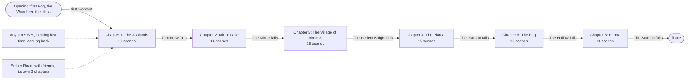

## Problem paths

Found by the walks. A scene lost, played after its ending, played before its question, or never reached fails `pnpm test`, so none are left. What is listed here is allowed, to look at.

### Optional scenes the fast walk dropped (4)

- `ch1-small-day`: Optional (4 workouts · in chapter 1 · after a short workout): the fast walk never got that day before Tomorrow fell.
- `ch3-knight-cracks`: Optional (in chapter 3 · after a short workout): the fast walk never got that day before The Perfect Knight fell.
- `ch4-sol-socks`: Optional (5 workouts · in chapter 4 · rest day · sol = yes): the fast walk never got that day before The Plateau fell.
- `ch5-short`: Optional (1 workout · in chapter 5 · after a short workout): the fast walk never got that day before The Hollow fell.

### Flame growth lands in another chapter (4)

- `ch1-candle`: In the fast walk it plays in chapter 2 (workout 6), not in chapter 1 where it is written.
- `ch2-torch`: In the fast walk it plays in chapter 4 (workout 15), not in chapter 2 where it is written.
- `ch5-wings`: In the planned walk it plays in chapter 4 (workout 50), not in chapter 5 where it is written.
- `ch5-wings`: In the alone walk it plays in chapter 4 (workout 50), not in chapter 5 where it is written.

## Answers that carry

Each question, and every scene that reads its answer later. A scene that waits for an answer is skipped without it; lines that read it drop out.

### why, want, forWho, remind (asked in first-letter)

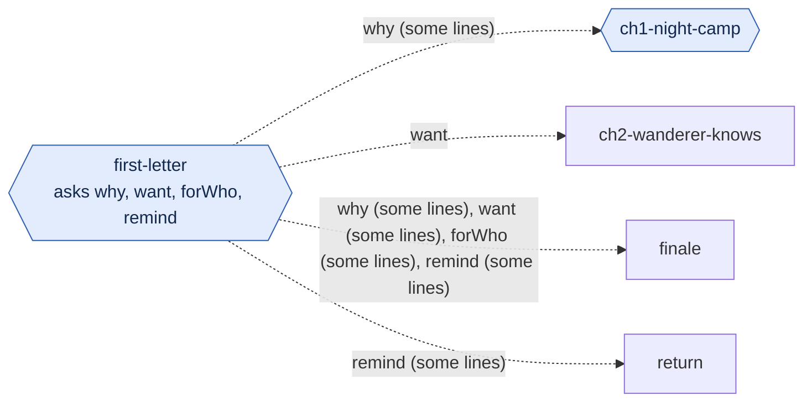

### lia (asked in ch2-lia)

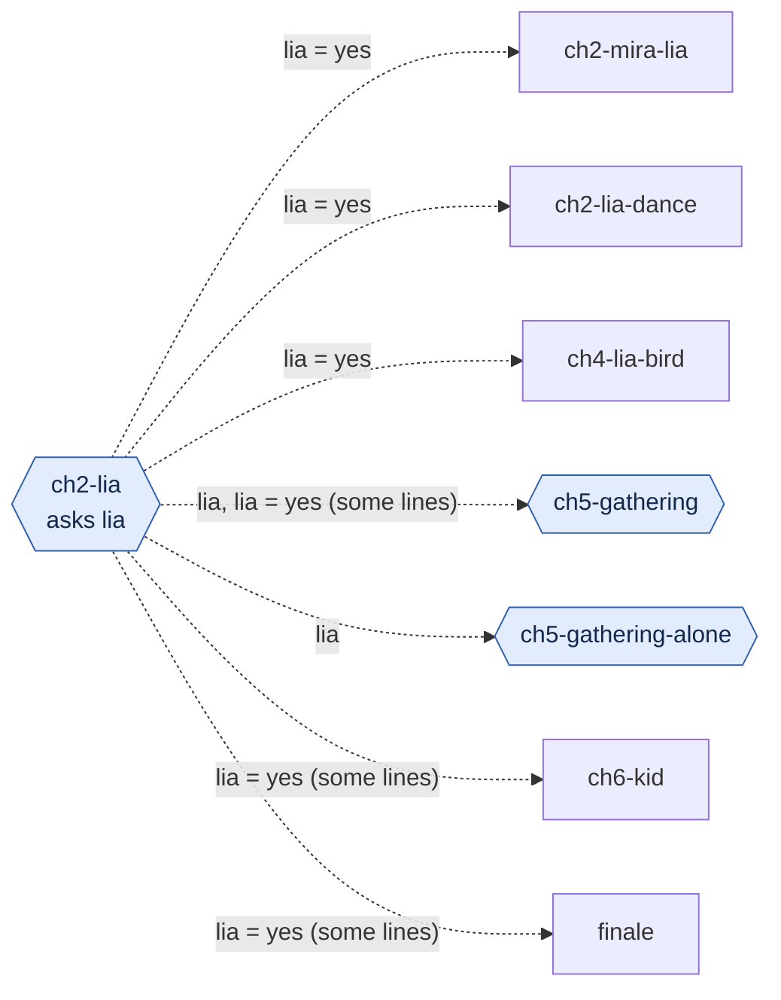

### heart2 (asked in ch2-heart)

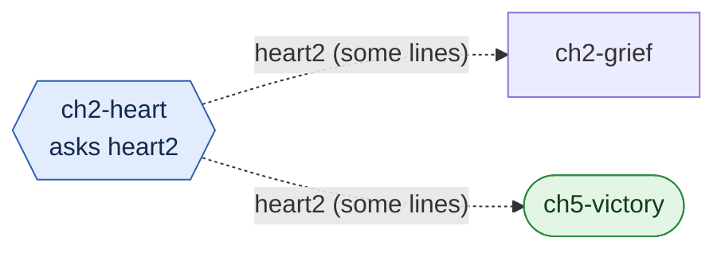

### sol (asked in ch3-sol)

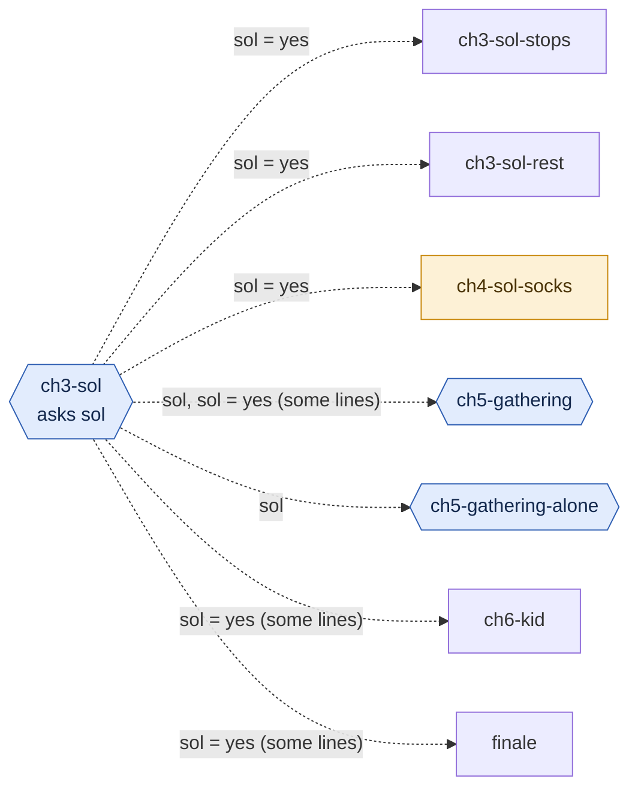

### vela (asked in ch4-vela)

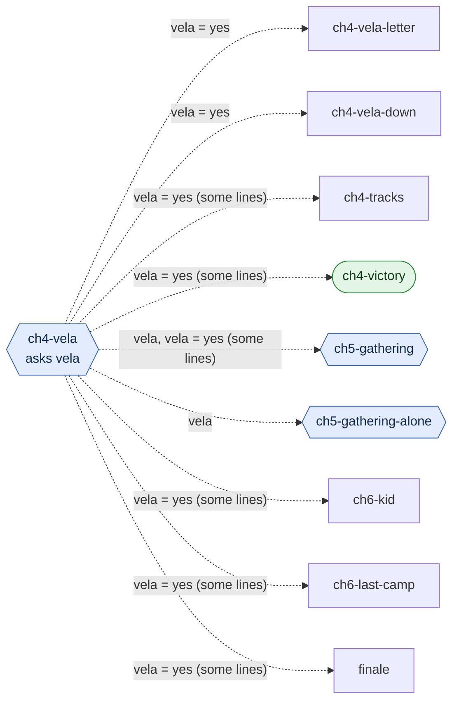

### heart4 (asked in ch4-heart)

### heart3 (asked in ch3-knight-kneels)

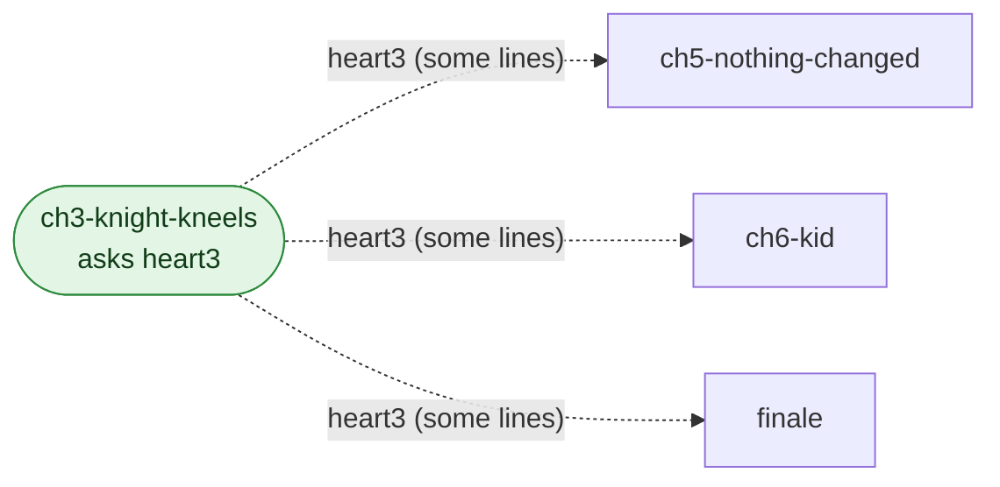

### heart5 (asked in ch5-heart)

### heart1 (asked in ch1-night-camp)

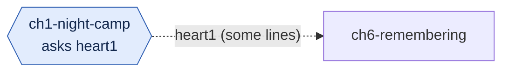

### heart6 (asked in ch6-heart)

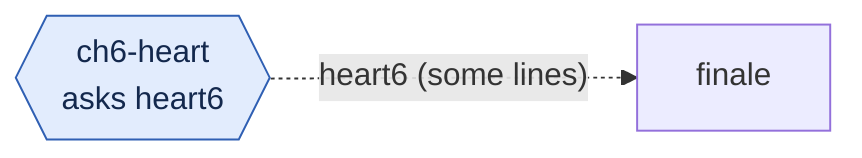

## Chapter 1: The Ashlands

Ends when Tomorrow falls in the Fog. Planned length 12 workouts. `workouts` below count from the chapter's start.

```mermaid
flowchart TD
  first_quest["first-quest<br/>1 workout"]
  first_letter{{"first-letter<br/>1 workout · no letter yet"}}
  flame_name{{"flame-name<br/>1 workout"}}
  first_rest_day["first-rest-day<br/>1 workout · rest day"]
  ch1_kept["ch1-kept<br/>2 workouts · chapter 1 started"]
  class_choice{{"class-choice<br/>3 workouts · no class yet"}}
  ch1_breath["ch1-breath<br/>3 workouts · chapter 1 started"]
  perfect_week["perfect-week<br/>a full week"]
  ch1_wanderer_first["ch1-wanderer-first<br/>4 workouts · chapter 1 started"]
  ch1_tomorrow_splits["ch1-tomorrow-splits<br/>5 workouts"]
  mira_forge["mira-forge<br/>6 workouts · up to chapter 2"]
  ch1_candle["ch1-candle<br/>flame grown to candle"]
  ch1_small_day["ch1-small-day<br/>4 workouts · in chapter 1 · after a short workout"]
  ch1_night_camp{{"ch1-night-camp<br/>8 workouts"}}
  ch1_tomorrow_begs["ch1-tomorrow-begs<br/>10 workouts"]
  ch1_proof["ch1-proof<br/>11 workouts · chapter 1 started"]
  ch1_victory(["ch1-victory<br/>boss 1 beaten"])
  first_quest --> first_letter
  first_letter --> flame_name
  flame_name --> first_rest_day
  first_rest_day --> ch1_kept
  ch1_kept --> class_choice
  class_choice --> ch1_breath
  ch1_breath --> perfect_week
  perfect_week --> ch1_wanderer_first
  ch1_wanderer_first --> ch1_tomorrow_splits
  ch1_tomorrow_splits --> mira_forge
  mira_forge --> ch1_candle
  ch1_candle --> ch1_small_day
  ch1_small_day --> ch1_night_camp
  ch1_night_camp --> ch1_tomorrow_begs
  ch1_tomorrow_begs --> ch1_proof
  ch1_proof --> ch1_victory
  first_letter -.->|"why"| ch1_night_camp
  classDef lost fill:#fde2e2,stroke:#c0392b,color:#5b1a12
  classDef only fill:#fdf1d6,stroke:#c98a10,color:#4a3305
  classDef ask fill:#e2ecfd,stroke:#2f5fb3,color:#13284d
  classDef done fill:#e3f6e5,stroke:#2e8b3e,color:#123d19
  class first_letter ask
  class flame_name ask
  class class_choice ask
  class first_rest_day only
  class perfect_week only
  class ch1_small_day only
  class ch1_night_camp ask
  class ch1_victory done
```

| Scene | Plays when | Asks | Notes | planned | fast | alone |
| --- | --- | --- | --- | --- | --- | --- |
| `first-quest` | 1 workout |  |  | yes | yes | yes |
| `first-letter` | 1 workout · no letter yet | letter |  | yes | yes | yes |
| `flame-name` | 1 workout | name |  | yes | yes | yes |
| `first-rest-day` | 1 workout · rest day |  | optional | yes | yes | yes |
| `ch1-kept` | 2 workouts · chapter 1 started |  |  | yes | yes | yes |
| `class-choice` | 3 workouts · no class yet | class |  | yes | yes | yes |
| `ch1-breath` | 3 workouts · chapter 1 started |  |  | yes | yes | yes |
| `perfect-week` | a full week |  | optional | yes | yes | yes |
| `ch1-wanderer-first` | 4 workouts · chapter 1 started |  |  | yes | yes | yes |
| `ch1-tomorrow-splits` | 5 workouts |  |  | yes | yes | yes |
| `mira-forge` | 6 workouts · up to chapter 2 |  |  | yes | yes | yes |
| `ch1-candle` | flame grown to candle |  |  | yes | yes | yes |
| `ch1-small-day` | 4 workouts · in chapter 1 · after a short workout |  | optional | yes | **no** | yes |
| `ch1-night-camp` | 8 workouts | heart1 | reads why (first-letter) | yes | yes | yes |
| `ch1-tomorrow-begs` | 10 workouts |  |  | yes | yes | yes |
| `ch1-proof` | 11 workouts · chapter 1 started |  |  | yes | yes | yes |
| `ch1-victory` | boss 1 beaten |  | ends the chapter | yes | yes | yes |

## Chapter 2: Mirror Lake

Ends when The Mirror falls in the Fog. Planned length 12 workouts. `workouts` below count from the chapter's start.

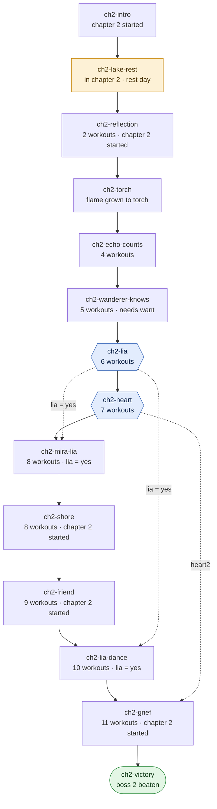

| Scene | Plays when | Asks | Notes | planned | fast | alone |
| --- | --- | --- | --- | --- | --- | --- |
| `ch2-intro` | chapter 2 started |  |  | yes | yes | yes |
| `ch2-lake-rest` | in chapter 2 · rest day |  | optional | yes | yes | yes |
| `ch2-reflection` | 2 workouts · chapter 2 started |  |  | yes | yes | yes |
| `ch2-torch` | flame grown to torch |  |  | yes | yes | yes |
| `ch2-echo-counts` | 4 workouts |  |  | yes | yes | yes |
| `ch2-wanderer-knows` | 5 workouts · needs {want} |  | reads want (first-letter) | yes | yes | yes |
| `ch2-lia` | 6 workouts | lia |  | yes | yes | yes |
| `ch2-heart` | 7 workouts | heart2 |  | yes | yes | yes |
| `ch2-mira-lia` | 8 workouts · lia = yes |  | reads lia (ch2-lia) | yes | yes | **no** |
| `ch2-shore` | 8 workouts · chapter 2 started |  |  | yes | yes | yes |
| `ch2-friend` | 9 workouts · chapter 2 started |  |  | yes | yes | yes |
| `ch2-lia-dance` | 10 workouts · lia = yes |  | reads lia (ch2-lia) | yes | yes | **no** |
| `ch2-grief` | 11 workouts · chapter 2 started |  | reads heart2 (ch2-heart) | yes | yes | yes |
| `ch2-victory` | boss 2 beaten |  | ends the chapter | yes | yes | yes |

## Chapter 3: The Village of Almosts

Ends when The Perfect Knight falls in the Fog. Planned length 13 workouts. `workouts` below count from the chapter's start.

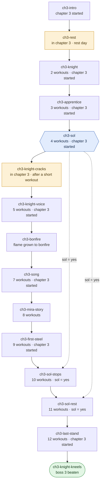

| Scene | Plays when | Asks | Notes | planned | fast | alone |
| --- | --- | --- | --- | --- | --- | --- |
| `ch3-intro` | chapter 3 started |  |  | yes | yes | yes |
| `ch3-rest` | in chapter 3 · rest day |  | optional | yes | yes | yes |
| `ch3-knight` | 2 workouts · chapter 3 started |  |  | yes | yes | yes |
| `ch3-apprentice` | 3 workouts · chapter 3 started |  |  | yes | yes | yes |
| `ch3-sol` | 4 workouts · chapter 3 started | sol |  | yes | yes | yes |
| `ch3-knight-cracks` | in chapter 3 · after a short workout |  | optional | yes | **no** | yes |
| `ch3-knight-voice` | 5 workouts · chapter 3 started |  |  | yes | yes | yes |
| `ch3-bonfire` | flame grown to bonfire |  |  | yes | **no** | yes |
| `ch3-song` | 7 workouts · chapter 3 started |  |  | yes | yes | yes |
| `ch3-mira-story` | 8 workouts |  |  | yes | yes | yes |
| `ch3-first-steel` | 9 workouts · chapter 3 started |  |  | yes | yes | yes |
| `ch3-sol-stops` | 10 workouts · sol = yes |  | reads sol (ch3-sol) | yes | yes | **no** |
| `ch3-sol-rest` | 11 workouts · sol = yes |  | reads sol (ch3-sol) | yes | yes | **no** |
| `ch3-last-stand` | 12 workouts · chapter 3 started |  |  | yes | yes | yes |
| `ch3-knight-kneels` | boss 3 beaten | heart3 | ends the chapter | yes | yes | yes |

## Chapter 4: The Plateau

Ends when The Plateau falls in the Fog. Planned length 13 workouts. `workouts` below count from the chapter's start.

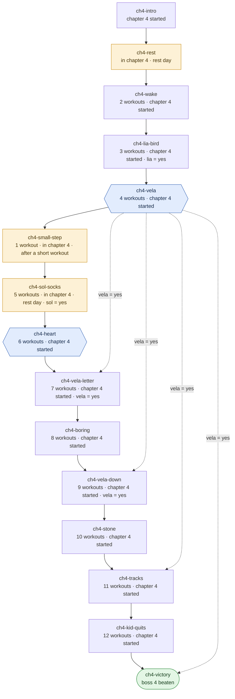

| Scene | Plays when | Asks | Notes | planned | fast | alone |
| --- | --- | --- | --- | --- | --- | --- |
| `ch4-intro` | chapter 4 started |  |  | yes | yes | yes |
| `ch4-rest` | in chapter 4 · rest day |  | optional | yes | yes | yes |
| `ch4-wake` | 2 workouts · chapter 4 started |  |  | yes | yes | yes |
| `ch4-lia-bird` | 3 workouts · chapter 4 started · lia = yes |  | reads lia (ch2-lia) | yes | yes | **no** |
| `ch4-vela` | 4 workouts · chapter 4 started | vela |  | yes | yes | yes |
| `ch4-small-step` | 1 workout · in chapter 4 · after a short workout |  | optional | yes | yes | yes |
| `ch4-sol-socks` | 5 workouts · in chapter 4 · rest day · sol = yes |  | optional, reads sol (ch3-sol) | yes | **no** | **no** |
| `ch4-heart` | 6 workouts · chapter 4 started | heart4 |  | yes | yes | yes |
| `ch4-vela-letter` | 7 workouts · chapter 4 started · vela = yes |  | reads vela (ch4-vela) | yes | yes | **no** |
| `ch4-boring` | 8 workouts · chapter 4 started |  |  | yes | yes | yes |
| `ch4-vela-down` | 9 workouts · chapter 4 started · vela = yes |  | reads vela (ch4-vela) | yes | yes | **no** |
| `ch4-stone` | 10 workouts · chapter 4 started |  |  | yes | yes | yes |
| `ch4-tracks` | 11 workouts · chapter 4 started |  | reads vela (ch4-vela) | yes | yes | yes |
| `ch4-kid-quits` | 12 workouts · chapter 4 started |  |  | yes | yes | yes |
| `ch4-victory` | boss 4 beaten |  | ends the chapter, reads vela (ch4-vela) | yes | yes | yes |

## Chapter 5: The Fog

Ends when The Hollow falls in the Fog. Planned length 14 workouts. `workouts` below count from the chapter's start.

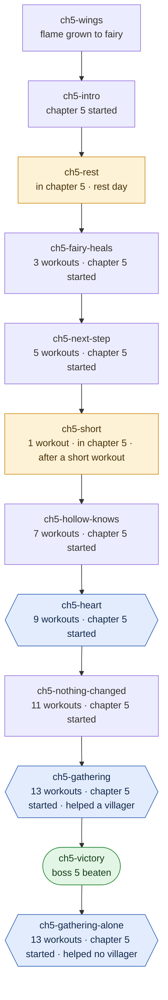

| Scene | Plays when | Asks | Notes | planned | fast | alone |
| --- | --- | --- | --- | --- | --- | --- |
| `ch5-wings` | flame grown to fairy |  |  | yes | **no** | yes |
| `ch5-intro` | chapter 5 started |  |  | yes | yes | yes |
| `ch5-rest` | in chapter 5 · rest day |  | optional | yes | yes | yes |
| `ch5-fairy-heals` | 3 workouts · chapter 5 started |  |  | yes | yes | yes |
| `ch5-next-step` | 5 workouts · chapter 5 started |  |  | yes | yes | yes |
| `ch5-short` | 1 workout · in chapter 5 · after a short workout |  | optional | yes | **no** | yes |
| `ch5-hollow-knows` | 7 workouts · chapter 5 started |  |  | yes | yes | yes |
| `ch5-heart` | 9 workouts · chapter 5 started | heart5 |  | yes | yes | yes |
| `ch5-nothing-changed` | 11 workouts · chapter 5 started |  | reads heart4 (ch4-heart), reads heart3 (ch3-knight-kneels) | yes | yes | yes |
| `ch5-gathering` | 13 workouts · chapter 5 started · helped a villager | call | reads lia (ch2-lia), reads sol (ch3-sol), reads vela (ch4-vela), reads lia (ch2-lia), reads sol (ch3-sol), reads vela (ch4-vela) | yes | yes | **no** |
| `ch5-victory` | boss 5 beaten |  | ends the chapter, reads heart2 (ch2-heart) | yes | yes | yes |
| `ch5-gathering-alone` | 13 workouts · chapter 5 started · helped no villager | call | reads lia (ch2-lia), reads sol (ch3-sol), reads vela (ch4-vela) | **no** | **no** | yes |

## Chapter 6: Forma

Ends when The Summit falls in the Fog. Planned length 14 workouts. `workouts` below count from the chapter's start.

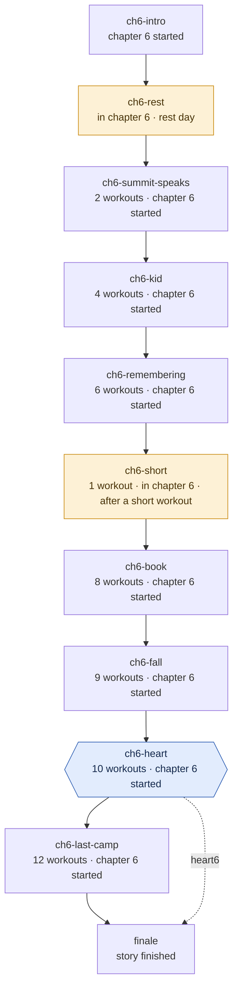

| Scene | Plays when | Asks | Notes | planned | fast | alone |
| --- | --- | --- | --- | --- | --- | --- |
| `ch6-intro` | chapter 6 started |  |  | yes | yes | yes |
| `ch6-rest` | in chapter 6 · rest day |  | optional | yes | yes | yes |
| `ch6-summit-speaks` | 2 workouts · chapter 6 started |  | reads heart5 (ch5-heart) | yes | yes | yes |
| `ch6-kid` | 4 workouts · chapter 6 started |  | reads heart3 (ch3-knight-kneels), reads lia (ch2-lia), reads sol (ch3-sol), reads vela (ch4-vela) | yes | yes | yes |
| `ch6-remembering` | 6 workouts · chapter 6 started |  | reads heart1 (ch1-night-camp) | yes | yes | yes |
| `ch6-short` | 1 workout · in chapter 6 · after a short workout |  | optional | yes | yes | yes |
| `ch6-book` | 8 workouts · chapter 6 started |  |  | yes | yes | yes |
| `ch6-fall` | 9 workouts · chapter 6 started |  |  | yes | yes | yes |
| `ch6-heart` | 10 workouts · chapter 6 started | heart6 |  | yes | yes | yes |
| `ch6-last-camp` | 12 workouts · chapter 6 started |  | reads vela (ch4-vela) | yes | yes | yes |
| `finale` | story finished |  | reads why (first-letter), reads want (first-letter), reads forWho (first-letter), reads remind (first-letter), reads heart6 (ch6-heart), reads lia (ch2-lia), reads sol (ch3-sol), reads vela (ch4-vela), reads heart3 (ch3-knight-kneels) | yes | yes | yes |

## Any time

Scenes from `anytime.ts`: `workouts` count every workout, whatever the chapter.

| Scene | Plays when | Asks | Notes | planned | fast | alone |
| --- | --- | --- | --- | --- | --- | --- |
| `sp-gift` | 3 workouts · has a class | sp |  | yes | yes | yes |
| `sp-awake` | SP trial done |  |  | yes | yes | yes |
| `sp-second` | boss 2 beaten · has a class | sp |  | yes | yes | yes |
| `sp-third` | boss 4 beaten · has a class | sp |  | yes | yes | yes |
| `sp-fourth` | boss 5 beaten · has a class | sp |  | yes | yes | yes |
| `first-better` | beat last time in 1 workout |  |  | yes | yes | yes |
| `good-steel` | boss 3 beaten · beat last time in 8 workouts |  |  | yes | yes | yes |
| `teach-me` | boss 3 beaten · beat last time in 4 workouts |  |  | yes | yes | yes |
| `smoky` | 4 days in a row |  |  | **no** | **no** | **no** |
| `heavy-days` | 6 workouts · last 3 workouts short |  |  | **no** | **no** | **no** |
| `return` | away 8+ days |  | reads remind (first-letter) | **no** | **no** | **no** |

## The Ember Road

Walked with friends (`road.ts`); no walk plays it.

| Scene | Plays when | Asks | Notes | planned | fast | alone |
| --- | --- | --- | --- | --- | --- | --- |
| `road-1-open` | Ember Road open 1 |  |  | **no** | **no** | **no** |
| `road-1-note` | Ember Road note 1 |  |  | **no** | **no** | **no** |
| `road-1-won` | Ember Road won 1 | road1 |  | **no** | **no** | **no** |
| `road-2-open` | Ember Road open 2 |  |  | **no** | **no** | **no** |
| `road-2-note` | Ember Road note 2 |  |  | **no** | **no** | **no** |
| `road-2-won` | Ember Road won 2 | road2 |  | **no** | **no** | **no** |
| `road-3-open` | Ember Road open 3 |  |  | **no** | **no** | **no** |
| `road-3-note` | Ember Road note 3 |  |  | **no** | **no** | **no** |
| `road-3-won` | Ember Road won 3 | road3 |  | **no** | **no** | **no** |
| `road-end` | Ember Road end |  |  | **no** | **no** | **no** |
